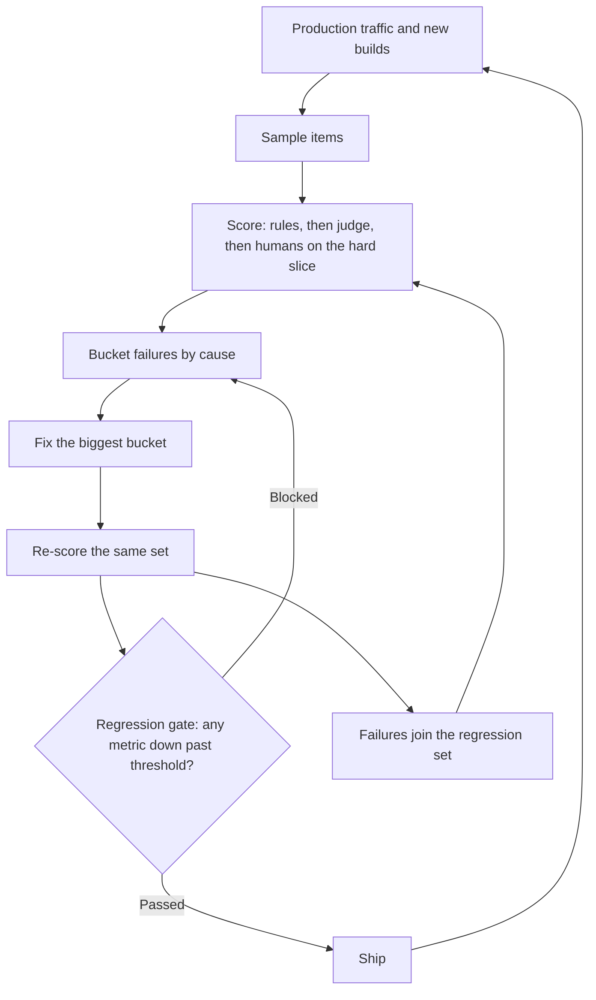

# The Eval Loop: Score, Bucket, Fix, Re-score, Gate

> The loop is the whole method. Everything else in this repo exists to make one turn of this loop cheaper or more honest.

---

---

## The Stages

| Stage | What happens | Failure if skipped |
|---|---|---|
| Sample | Pull items from production traffic and new builds, stratified by segment | You tune on the cases you imagined, not the ones users send |
| Score | Tiered: weak rules on everything, judge on the sample, humans on the hard and high risk slice | One expensive tier on everything bankrupts the loop; one cheap tier misses judgment failures |
| Bucket | Group failures by cause, rank by size | You get an average and a shrug instead of a work list |
| Fix | Attack the largest bucket only | Effort spreads across ten small causes and the score barely moves |
| Re-score | Same set, same config, compare bucket by bucket | You cannot tell whether the fix worked or the measurement drifted |
| Gate | Compare against baseline; block drops past the threshold | Regressions ship quietly and users find them for you |

---

## Loop Discipline

- **One turn, one fix.** Change one thing per turn, or you will never know which change moved the score.
- **The set only grows.** Failures join the regression set permanently. Items leave only when the product behavior they test is retired, and that decision is written down.
- **The loop runs on a cadence, not on enthusiasm.** Weekly in active development, on every release candidate, and on a production sample continuously. A loop that runs when someone remembers it is a loop that runs twice.
