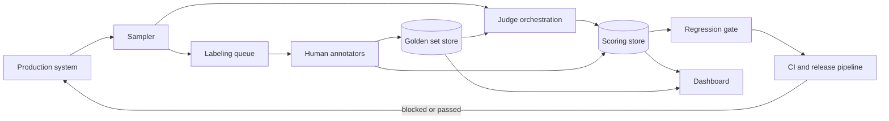

# Eval Platform Architecture: The Pieces and What Each One Earns

> An eval platform is not a dashboard. It is the loop from the eval_loop diagram, built as services: sampling in, scores out, and a gate that can stop a release.

---

---

## Components

| Component | Job | Failure if missing |
|---|---|---|
| Sampler | Pulls production outputs for scoring, stratified by segment, with privacy and retention rules applied | Eval runs on stale or cherry-picked items and stops matching reality |
| Labeling queue | Routes items to annotators with the rubric attached; tracks calibration and disagreements | Labels arrive without context, and agreement collapses quietly |
| Human annotators | Produce and adjudicate the labels everything else is validated against | No ground truth; every other component is grading its own homework |
| Golden set store | Versioned, frozen labeled sets; every score names the set version it used | Scores across weeks stop being comparable and nobody notices |
| Judge orchestration | Runs judge models with pinned prompts and rubric versions; logs evidence with each score | Judge changes silently and manufactures improvements and regressions |
| Scoring store | Every score ever produced, with item, config, judge, and set version attached | No history, no trend, no audit trail when a number is challenged |
| Regression gate | Compares runs to baseline and blocks releases on drops past threshold | The platform reports regressions and ships them anyway |
| Dashboard | Trends, buckets, and agreement rates where the team already looks | Results live in a tool nobody opens, so decisions happen without them |

---

## Design Notes

- **Version everything that can change a score:** the set, the rubric, the judge model, the judge prompt, the scoring code. A score without its five versions is an anecdote.
- **Store evidence, not just numbers.** The judge quote and the annotator note are what make a disputed score resolvable in minutes instead of meetings.
- **The gate is a separate service on purpose.** If the team that ships can also configure the gate in the same deploy, the gate will be configured. Threshold changes deserve their own review.
- **Sample continuously, label selectively.** Production sampling never stops; human labeling spends itself on new segments, disagreement heavy categories, and the quarterly coverage audit.
